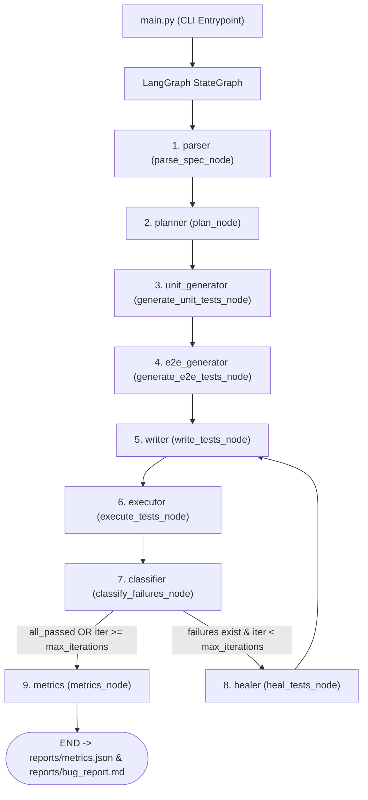

# Autonomous API Testing & Code Generation Agent — Complete Technical Documentation

This document provides an exhaustive, end-to-end engineering reference for the **Autonomous API Testing & Code Generation Agent** project. It covers the project methodology, system architecture, repository structure, verification fixes, and a **line-by-line code walkthrough of every file** in the repository.

---

## Table of Contents

1. [Methodology & Engineering Principles](#1-methodology--engineering-principles)
2. [System Architecture & Pipeline Flow](#2-system-architecture--pipeline-flow)
3. [Repository Structure](#3-repository-structure)
4. [Line-by-Line Code Reference](#4-line-by-line-code-reference)
   - [4.1 Dependencies: `requirements.txt`](#41-dependencies-requirementstxt)
   - [4.2 Package Markers & Placeholders](#42-package-markers--placeholders)
   - [4.3 `benchmark_app/models.py`](#43-benchmark_appmodelspy)
   - [4.4 `benchmark_app/main.py`](#44-benchmark_appmainpy)
   - [4.5 `benchmark_app/Dockerfile.target`](#45-benchmark_appdockerfiletarget)
   - [4.6 `docker/Dockerfile.sandbox`](#46-dockerdockerfilesandbox)
   - [4.7 `docker/docker-compose.yml`](#47-dockerdocker-composeyml)
   - [4.8 `src/parser/openapi_parser.py`](#48-srcparseropenapi_parserpy)
   - [4.9 `src/agent/state.py`](#49-srcagentstatepy)
   - [4.10 `src/agent/prompts.py`](#410-srcagentpromptspy)
   - [4.11 `src/agent/graph.py`](#411-srcagentgraphpy)
   - [4.12 `src/agent/nodes.py`](#412-srcagentnodespy)
   - [4.13 `src/sandbox/runner.py`](#413-srcsandboxrunnerpy)
   - [4.14 `main.py`](#414-mainpy)
   - [4.15 `generated_tests/conftest.py`](#415-generated_testsconftestpy)
   - [4.16 `generated_tests/test_unit_endpoints.py`](#416-generated_teststest_unit_endpointspy)
   - [4.17 `generated_tests/test_e2e_playwright.py`](#417-generated_teststest_e2e_playwrightpy)
   - [4.18 `README.md`](#418-readmemd)
5. [Verification Fixes & Engineering Observations](#5-verification-fixes--engineering-observations)

---

## 1. Methodology & Engineering Principles

### 1.1 The Black-Box Rule
A core architectural constraint of this project is strict **black-box testing**:
- The agent **never reads** the target FastAPI application's Python source code (`benchmark_app/`).
- Its sole sources of truth are:
  1. The live HTTP `GET /openapi.json` contract exposed by the running service.
  2. Runtime HTTP status codes, JSON payloads, and `pytest` tracebacks returned by the sandboxed test runner.
- Because the OpenAPI specification is treated as the authoritative contract, any divergence between the spec and runtime server behavior is flagged as a defect in the API rather than hidden by adjusting test expectations.

### 1.2 Local 7B/14B LLM Hardware & Context-Window Methodology
The agent is engineered to run against local Ollama models (default: `qwen2.5-coder:7b`) on a single consumer RTX GPU:
- **Context Budget (`num_ctx=8192`) & Low Temperature (`temperature=0.1`):** Configured in `get_llm()` (`src/agent/nodes.py`) to keep code generation deterministic and well within 8K VRAM limits.
- **Per-Endpoint Prompt Chunking:** Rather than stuffing the entire OpenAPI specification into one giant prompt, `generate_unit_tests_node` loops over each `EndpointInfo` object individually and sends one tightly bounded prompt per endpoint (`request_body` truncated to 500 chars, `path_params` to 200 chars, `response_schema` to 400 chars, `example_payload` to 300 chars).
- **Deterministic Template Offloading:** Non-creative boilerplate—specifically `generated_tests/conftest.py`—is rendered deterministically in Python (`write_tests_node`) rather than calling the LLM on every healing iteration, saving ~2K tokens per cycle and eliminating fixture syntax drift.

### 1.3 Deterministic `$ref` Resolution & Dependency Graphing
OpenAPI specs generated by FastAPI heavily rely on JSON Pointer references (`"$ref": "#/components/schemas/ItemCreate"`). Local 7B models frequently hallucinate field names if forced to chase `$ref` strings across a large document.
- `src/parser/openapi_parser.py` fetches `/openapi.json` once and runs `_resolve_refs()` recursively with `copy.deepcopy()` and a `_visiting` cycle guard (`{"$circular_ref": ref_str}`) so every endpoint receives a self-contained, inline JSON Schema.
- `build_dependency_graph()` constructs an adjacency graph placing resource-creating `POST` operations before `GET`/`PUT`/`PATCH`/`DELETE` operations that require path parameters on the same resource base.
- `generate_example_payload()` synthesizes schema-compliant JSON payloads respecting `minLength`, `maxLength`, `gt`, `exclusiveMinimum`, `minimum`, `format`, `enum`, `default`, `example`, `allOf`/`anyOf`/`oneOf`, and nested objects/arrays.

### 1.4 Two-Tier Test Generation Strategy
1. **Unit & Schema Boundary Tests (`generated_tests/test_unit_endpoints.py`):** Generated using `httpx.Client` to verify:
   - Happy paths (`200` / `201` / `204`)
   - Pydantic validation boundaries (`422 Unprocessable Entity`, e.g., string `min_length`, numeric `gt=0`)
   - Authentication enforcement (`401 Unauthorized` when missing/invalid Bearer JWT)
2. **Stateful E2E & Browser Smoke Tests (`generated_tests/test_e2e_playwright.py`):** Generated using `pytest-playwright` (`APIRequestContext` + `Page`):
   - Multi-step stateful user journey: `Register -> Login -> Create Item -> Read Item -> Update Item -> Delete Item -> Verify Deleted (404)`.
   - Headless Chromium UI smoke test against `/docs` verifying Swagger UI loads, page title contains `"Swagger"`, and `.opblock` endpoint entries render.

### 1.5 Self-Healing Loop (`TEST_BUG` vs. `API_BUG`)
After executing tests, any failure enters `classify_failures_node` -> conditional edge `should_heal_or_finish` -> `heal_tests_node` (capped at `max_iterations=3`):
- **`TEST_BUG`:** The test violated syntax, fixture usage, payload constraints, or asserted something contradicting the OpenAPI spec. **Action:** Replace the failing function body with the LLM-repaired function (`healed_unit_tests` / `healed_e2e_tests`) and re-run.
- **`API_BUG`:** The test strictly obeyed the OpenAPI contract, yet the server returned an undocumented `500`, wrong status code (e.g., `200` instead of `204`), or broken response semantics. **Action:** Preserve the test and decorate it with `@pytest.mark.xfail(reason="API_BUG: ...", strict=True)` while logging the evidence into `reports/bug_report.md`. Using `strict=True` ensures that if the API bug is later fixed on the server, pytest will fail (`XPASS`) to alert maintainers to remove the `xfail` marker.

### 1.6 Sandboxed Docker Execution
Tests run inside `sandbox_runner` (`mcr.microsoft.com/playwright/python:v1.47.0-jammy`) connected to `target_api` over an isolated Docker bridge network (`test_net`):
- `sandbox_runner` starts only after `target_api` passes its `/openapi.json` healthcheck.
- `generated_tests/` and `reports/` are bind-mounted into the container so `pytest-json-report` writes `/reports/report.json` directly back to the host.
- A `--local` fallback mode (`SANDBOX_MODE=local`) executes `pytest` directly in a subprocess when Docker is unavailable or rapid local iteration is desired.

---

## 2. System Architecture & Pipeline Flow



---

## 3. Repository Structure

```text
autonomous-api-testing-agent/
├── benchmark_app/                  # Deliberately buggy FastAPI target (never read by agent)
│   ├── __init__.py                 # Package marker
│   ├── main.py                     # FastAPI CRUD + JWT auth + BUG-1, BUG-2, BUG-3
│   ├── models.py                   # Pydantic v2 schemas with validation constraints
│   └── Dockerfile.target           # Container image for target_api
├── docker/
│   ├── Dockerfile.sandbox          # Playwright Chromium + pytest runner container
│   └── docker-compose.yml          # Isolated test_net bridge network & healthcheck
├── src/
│   ├── __init__.py                 # Package marker
│   ├── parser/
│   │   ├── __init__.py             # Package marker
│   │   └── openapi_parser.py       # OpenAPI fetcher, $ref resolver, dep graph, payload gen
│   ├── agent/
│   │   ├── __init__.py             # Package marker
│   │   ├── state.py                # AgentState & TestResult TypedDicts
│   │   ├── prompts.py              # Scoped prompts for local 7B Ollama
│   │   ├── graph.py                # LangGraph StateGraph & conditional routing
│   │   └── nodes.py                # All 9 node implementations
│   └── sandbox/
│       ├── __init__.py             # Package marker
│       └── runner.py               # Docker Compose / local pytest runner & JSON parser
├── generated_tests/                # Output dir mounted to /tests in Docker
│   ├── .gitkeep
│   ├── conftest.py                 # Session fixtures (client, registered_user, auth_headers)
│   ├── test_unit_endpoints.py      # Seed/generated httpx unit & boundary tests
│   └── test_e2e_playwright.py      # Seed/generated Playwright E2E + /docs smoke test
├── reports/
│   └── .gitkeep                    # Runtime outputs: report.json, metrics.json, bug_report.md
├── main.py                         # CLI entrypoint
├── requirements.txt                # Host Python dependencies
└── README.md                       # Quick-start & high-level overview
```

---

## 4. Line-by-Line Code Reference

### 4.1 Dependencies: `requirements.txt`

| Lines | Content | Purpose |
|---|---|---|
| `L1` | `langchain-ollama>=0.2.0` | Provides `ChatOllama` LangChain wrapper for local Ollama inference. |
| `L2` | `langchain-core>=0.3.0` | Core message abstractions (`SystemMessage`, `HumanMessage`). |
| `L3` | `langgraph>=0.2.0` | Cyclic `StateGraph` orchestration engine and `END` sentinel. |
| `L4` | `pydantic>=2.0.0` | Schema validation library (v2). |
| `L5` | `httpx>=0.27.0` | Synchronous HTTP client used by the OpenAPI parser and generated unit tests. |
| `L6` | `docker>=7.0.0` | Docker Python SDK (declared as dependency alongside `subprocess` `docker compose` orchestration). |
| `L7` | `pytest>=8.0.0` | Core test runner. |
| `L8` | `pytest-playwright>=0.5.0` | Provides `playwright` and `page` fixtures for API and Chromium E2E tests. |
| `L9` | `pytest-json-report>=1.5.0` | Generates structured `report.json` with test outcomes and tracebacks. |
| `L10` | `ollama>=0.3.0` | Underlying Ollama Python client required by `langchain-ollama`. |
| `L11` | `python-multipart>=0.0.9` | Form-data parsing support (`OAuth2PasswordRequestForm`). |

---

### 4.2 Package Markers & Placeholders

- `benchmark_app/__init__.py` (empty): Marks `benchmark_app` as an importable Python package so `uvicorn benchmark_app.main:app` resolves cleanly inside `Dockerfile.target`.
- `src/__init__.py`, `src/parser/__init__.py`, `src/agent/__init__.py`, `src/sandbox/__init__.py` (empty): Standard Python package markers enabling absolute imports like `from src.agent.graph import build_graph`.
- `generated_tests/.gitkeep`, `reports/.gitkeep` (empty): Preserve empty runtime directories in version control before tests/reports are generated.

---

### 4.3 `benchmark_app/models.py`

| Lines | Code / Construct | Explanation |
|---|---|---|
| `L1–L2` | `from pydantic import BaseModel, Field` / `from typing import Optional` | Imports Pydantic v2 base class, field constraint builder, and optional type hint. |
| `L5–L7` | `class UserCreate(BaseModel):` | Registration input schema. `username` requires 3–50 characters (`min_length=3, max_length=50`); `password` requires at least 6 characters (`min_length=6`). Violating either triggers FastAPI HTTP `422`. |
| `L10–L12` | `class UserResponse(BaseModel):` | Public user representation returned after registration (`id: int`, `username: str`), intentionally omitting `password`. |
| `L15–L17` | `class Token(BaseModel):` | OAuth2 bearer token response (`access_token: str`, `token_type: str`). |
| `L20–L23` | `class ItemCreate(BaseModel):` | Item creation payload: `title` (`1..100` chars), optional `description`, and `price` strictly greater than zero (`gt=0`). |
| `L26–L29` | `class ItemUpdate(BaseModel):` | Partial/full update payload where all fields default to `None` (`Optional`) while retaining `min_length`/`max_length`/`gt=0` constraints when provided. |
| `L32–L37` | `class ItemResponse(BaseModel):` | Full item output schema adding server-assigned `id: int` and `owner_id: int`. |

---

### 4.4 `benchmark_app/main.py`

| Lines | Code / Construct | Explanation |
|---|---|---|
| `L1–L4` | Module docstring | Documents the benchmark FastAPI app and notes its 3 intentional defects (`BUG-1`, `BUG-2`, `BUG-3`). |
| `L6–L21` | Imports | Imports `datetime`/`timedelta`, typing generics, FastAPI core classes, `JSONResponse`/`Response`, `OAuth2PasswordBearer`/`OAuth2PasswordRequestForm`, `python-jose` (`JWTError`, `jwt`), and the 6 Pydantic models from `benchmark_app.models`. |
| `L24–L26` | JWT configuration | Sets `SECRET_KEY = "test-secret-key-for-benchmark"`, `ALGORITHM = "HS256"`, and `ACCESS_TOKEN_EXPIRE_MINUTES = 60`. |
| `L29–L32` | In-memory database | Initializes `users_db: Dict[str, dict]`, `items_db: Dict[int, dict]`, and auto-increment counters `user_id_counter` and `item_id_counter`. |
| `L35–L41` | `app = FastAPI(...)` & `oauth2_scheme` | Instantiates FastAPI (automatically serving `/openapi.json` and `/docs`) and configures OAuth2 password bearer auth pointing to `tokenUrl="/auth/token"`. |
| `L46–L52` | `_hash_password` / `_verify_password` | Simple deterministic `"hashed:{password}"` helper for benchmark isolation. |
| `L55–L59` | `_create_access_token` | Copies payload dict, adds UTC `exp` claim (defaulting to 15 minutes if `expires_delta` omitted), and signs HS256 JWT with `jwt.encode`. |
| `L62–L80` | `get_current_user` dependency | Extracts Bearer token via `oauth2_scheme`, decodes JWT, validates `sub` claim, looks up `users_db[username]`, and raises HTTP `401 Unauthorized` (`WWW-Authenticate: Bearer`) on any `JWTError` or missing user. |
| `L85–L106` | `POST /auth/register` | Declares `201 Created` (`UserResponse`) and `422` in OpenAPI. Checks `users_db` for duplicate username (raises `400`), increments `user_id_counter`, stores hashed password, returns `UserResponse`. |
| `L109–L127` | `POST /auth/token` | Accepts form-encoded `OAuth2PasswordRequestForm`. Validates user existence and password (raises `401` on mismatch), mints 60-minute JWT with `"sub": username`, returns `Token(..., token_type="bearer")`. |
| `L132–L156` | `POST /items/` (**BUG-3**) | Requires `get_current_user`. Declares `201 Created` (`ItemResponse`), `401`, `422`. Increments `item_id_counter` and builds `item` dict. **Line 152 (`# BUG-3`):** hardcodes `"price": 0.0` instead of `item_in.price`, causing the response schema to still validate (`float`) while violating business logic. |
| `L159–L169` | `GET /items/` | Authenticated route returning `[ItemResponse(**item) for item in items_db.values()]` (`200 OK`). |
| `L172–L186` | `GET /items/{item_id}` (**BUG-2**) | Authenticated route declaring `200`, `401`, and `404` in OpenAPI. **Line 185 (`# BUG-2`):** directly indexes `items_db[item_id]` without checking membership, raising an unhandled `KeyError` that FastAPI/Starlette converts into a `500 Internal Server Error` when `item_id` does not exist. |
| `L189–L214` | `PUT /items/{item_id}` | Authenticated route declaring `200`, `401`, `404`, `422`. Correctly raises `404` if missing; updates only non-`None` fields from `ItemUpdate`; saves and returns `ItemResponse`. |
| `L217–L235` | `DELETE /items/{item_id}` (**BUG-1**) | Authenticated route declaring `status_code=204` (`204`, `401`, `404` in OpenAPI). Checks existence (`404` if absent), deletes from `items_db`, then at **Line 235 (`# BUG-1`)** returns `JSONResponse(status_code=200, content={"deleted": True})`, directly violating its own `204` OpenAPI contract. |

---

### 4.5 `benchmark_app/Dockerfile.target`

| Lines | Instruction | Explanation |
|---|---|---|
| `L1` | `FROM python:3.11-slim` | Lightweight Python 3.11 base image. |
| `L2` | `WORKDIR /app` | Sets working directory inside container. |
| `L3` | `RUN pip install --no-cache-dir ...` | Installs `fastapi`, `uvicorn[standard]`, `pyjwt`, `sqlalchemy`, `pydantic`, `python-multipart`, and `python-jose[cryptography]`. |
| `L4` | `COPY benchmark_app/ ./benchmark_app/` | Copies only the target application package into `/app/benchmark_app`. |
| `L5` | `EXPOSE 8000` | Documents port `8000`. |
| `L6` | `CMD ["uvicorn", "benchmark_app.main:app", "--host", "0.0.0.0", "--port", "8000"]` | Binds Uvicorn to all interfaces on port `8000` so `sandbox_runner` can reach it over the bridge network. |

---

### 4.6 `docker/Dockerfile.sandbox`

| Lines | Instruction | Explanation |
|---|---|---|
| `L1` | `FROM mcr.microsoft.com/playwright/python:v1.47.0-jammy` | Official Microsoft Playwright Python image pre-bundled with Chromium and system dependencies on Ubuntu Jammy. |
| `L2` | `WORKDIR /tests` | Default working directory where generated tests are mounted. |
| `L3–L9` | `RUN pip install --no-cache-dir ...` | Installs `pytest>=8.0.0`, `httpx>=0.27.0`, `pytest-playwright>=0.5.0`, `pytest-json-report>=1.5.0`, `pytest-xdist>=3.5.0`, and `lxml`. |
| `L10` | `ENV TARGET_API_URL=http://target_api:8000` | Points test fixtures to the `target_api` Docker service DNS name. |
| `L11` | `CMD ["pytest", "/tests", "--tb=short", "--json-report", "--json-report-file=/reports/report.json", "-v", "--ignore=/tests/reports"]` | Runs all tests in `/tests`, emits short tracebacks, writes structured JSON results to `/reports/report.json`, and ignores any nested `/tests/reports` directory. |

---

### 4.7 `docker/docker-compose.yml`

| Lines | Section | Explanation |
|---|---|---|
| `L1` | `version: "3.9"` | Compose specification version. |
| `L3–L18` | `services.target_api` | Builds `benchmark_app/Dockerfile.target` from parent context `..`, names container `target_api`, exposes host `8000:8000`, attaches to `test_net`, and polls `http://localhost:8000/openapi.json` every 5s (15 retries, 10s start period) for health. |
| `L20–L36` | `services.sandbox_runner` | Builds `docker/Dockerfile.sandbox`, waits for `target_api` `condition: service_healthy`, bind-mounts `../generated_tests:/tests` and `../reports:/reports`, joins `test_net`, injects `TARGET_API_URL=http://target_api:8000`, and uses `profiles: ["runner"]` so `docker compose up` does not run tests unless `--profile runner` is explicitly passed. |
| `L38–L40` | `networks.test_net` | Isolated Docker bridge network connecting `target_api` and `sandbox_runner`. |

---

### 4.8 `src/parser/openapi_parser.py`

| Lines | Construct | Explanation |
|---|---|---|
| `L1–L10` | Docstring & imports | Enables `from __future__ import annotations`, imports `copy`, `json`, `dataclass`/`field`, typing helpers, and `httpx`. |
| `L18–L30` | `@dataclass class EndpointInfo` | Canonical normalized representation of an API operation: `path`, `method`, `operation_id`, `summary`, `tags`, `requires_auth`, `path_params`, `query_params`, `request_body`, `responses`, and `success_status_code`. |
| `L38–L52` | `_resolve_ref(ref, root)` | Validates local JSON Pointer (`#/...`), splits path tokens, unescapes RFC 6901 tokens (`~1` -> `/`, `~0` -> `~`), and traverses dicts/lists in `root` to return the referenced node. |
| `L55–L78` | `_resolve_refs(obj, root, _visiting)` | Recursively walks dicts and lists. When encountering `"$ref"`, checks `_visiting` to break cycles (`{"$circular_ref": ref_str}`), adds `ref_str` to a new set (`_visiting \| {ref_str}`), fetches target via `_resolve_ref`, `copy.deepcopy()`s it so shared definitions stay independent, and recursively resolves nested `$ref`s inside it. |
| `L86–L93` | `_scheme_requires_auth(scheme)` | Returns `True` if OpenAPI `securitySchemes` entry has `type == "oauth2"` or `type == "http"` with `scheme == "bearer"`. |
| `L96–L111` | `_endpoint_requires_auth(...)` | Uses operation-level `security` if present (else falls back to `global_security`), checks each requirement object against `security_schemes`, and returns `True` if any scheme is OAuth2 or HTTP Bearer. |
| `L119–L134` | `parse_spec(url)` (fetch & resolve) | Calls `httpx.get(url, timeout=30.0)`, raises on HTTP errors, parses JSON, runs `_resolve_refs(raw_spec, raw_spec)`, and extracts `components.securitySchemes` and global `security`. |
| `L136–L173` | Path & parameter extraction | Iterates every path and HTTP method (`get`, `post`, `put`, `patch`, `delete`, `head`, `options`). Computes `operation_id` (falling back to `{method}_{sanitized_path}`), merges path-level and operation-level parameters keyed by `(name, in)` so operation-level overrides path-level, and splits into `path_params` and `query_params`. |
| `L175–L187` | Request body extraction | Extracts the resolved schema directly from `requestBody.content`, preferring `application/json`, then `application/x-www-form-urlencoded`, then the first available media type. |
| `L189–L225` | Response & success-code extraction | Maps each status code in `responses` to its resolved `application/json` schema (or `{}` if empty), determines `success_status_code` preferring `"201"`, `"200"`, `"204"` (default `200`), and appends an `EndpointInfo`. |
| `L227–L229` | Deterministic sorting | Sorts endpoints by `(e.tags[0] if e.tags else "", e.path, e.method)` so test generation order is deterministic across runs. |
| `L237–L268` | `build_dependency_graph(endpoints)` | Initializes an adjacency dict `{operation_id: []}`. `_resource_base()` strips trailing `{param}` path segments. Maps `POST` endpoints without `path_params` as resource creators, then adds directed edges `creator_id -> ep.operation_id` for `GET`/`PUT`/`PATCH`/`DELETE` endpoints that take `path_params` on the same resource base. |
| `L276–L359` | `generate_example_payload(schema)` | Recursively builds minimal valid example values: handles `allOf`/`anyOf`/`oneOf` (first sub-schema), `"example"`, `"default"`, `"enum"`, `object` (`properties`), `array` (`[item]`), `string` (honoring `format` like `email`/`date-time`/`date`/`uri`, `minLength`, `maxLength`), `number`/`float` (`gt`, `exclusiveMinimum`, `minimum`), `integer`, `boolean`, and `null`. |
| `L367–L395` | `if __name__ == "__main__":` | Standalone diagnostic CLI accepting an optional spec URL (default `http://localhost:8000/openapi.json`), printing discovered endpoints, auth flags, example payloads, and the dependency graph. |

---

### 4.9 `src/agent/state.py`

| Lines | Construct | Explanation |
|---|---|---|
| `L1–L2` | Imports | `TypedDict`, typing generics, `Annotated`, and `operator` (used for list-append reducer). |
| `L4–L9` | `class TestResult(TypedDict)` | Schema for each parsed test outcome: `test_name`, `status` (`passed`/`failed`/`error`/`xfail`), `failure_type` (`TEST_BUG`/`API_BUG`/`None`), `traceback`, and `heal_action`. |
| `L11–L38` | `class AgentState(TypedDict)` | Complete LangGraph shared state across all 9 nodes: **Inputs** (`target_api_url`, `openapi_spec`, `endpoints`), **Generation** (`generated_unit_tests`, `generated_e2e_tests`, `generated_conftest`), **Execution & Healing** (`iteration`, `max_iterations`, `test_results`, `unit_test_failures`, `e2e_test_failures`, `healed_unit_tests`, `healed_e2e_tests`), **Outputs** (`all_passed`, `bug_reports`, `metrics`), and **Control flow** (`error`, plus `messages: Annotated[List[str], operator.add]` which tells LangGraph to append new log entries rather than overwrite previous ones). |

---

### 4.10 `src/agent/prompts.py`

| Lines | Constant | Explanation |
|---|---|---|
| `L1–L3` | Module docstring | Explains token-efficiency goal for local `qwen2.5-coder:7b`. |
| `L5–L11` | `UNIT_TEST_SYSTEM` | System prompt enforcing `httpx.Client`, OpenAPI-only testing, coverage of `200`/`201`, `422`, and `401`, black-box rule, and code-only output. |
| `L13–L24` | `UNIT_TEST_TEMPLATE` | Per-endpoint prompt injecting `{method}`, `{path}`, `{operation_id}`, `{requires_auth}`, `{success_status_code}`, `{request_body}`, `{path_params}`, `{response_schema}`, `{example_payload}`, requesting 3–5 functions using `client` and `auth_headers` fixtures. |
| `L26–L31` | `E2E_SYSTEM` | System prompt for Playwright `APIRequestContext` stateful journeys (`Register->Login->Create->Mutate->Delete`) using shared pytest fixtures. |
| `L33–L44` | `E2E_TEMPLATE` | Injects `{journey_name}`, `{steps}`, `{base_url}`, `{endpoint_schemas}` and explicitly requires a Chromium smoke test visiting `{base_url}/docs` checking `"Swagger"` in title and visible endpoint blocks. |
| `L46–L52` | `HEAL_SYSTEM` | Self-healing system prompt reinforcing the Black-Box Rule and strict `TEST_BUG` vs. `API_BUG` definitions. |
| `L54–L71` | `HEAL_TEMPLATE` | Provides `{original_test}`, `{traceback}`, and `{endpoint_spec}`, lists explicit classification rules, and requests JSON (`classification`, `reason`, `fixed_code`) followed by the fixed Python function. |
| `L73–L81` | `CONFTEST_TEMPLATE` | Template string describing `conftest.py` fixtures (retained in `prompts.py` for reference; `write_tests_node` now renders `conftest.py` deterministically without an LLM call). |

---

### 4.11 `src/agent/graph.py`

| Lines | Construct | Explanation |
|---|---|---|
| `L1–L3` | Imports | `StateGraph`, `END`, and `AgentState`. |
| `L5–L15` | `should_heal_or_finish(state)` | Conditional router after `classifier`: returns `"metrics"` if `all_passed` is True, or if `iteration >= max_iterations`, or if no failures exist; otherwise returns `"healer"` to start another repair cycle. |
| `L17–L58` | `build_graph()` | Imports all 9 node functions from `src.agent.nodes`, registers nodes (`parser`, `planner`, `unit_generator`, `e2e_generator`, `writer`, `executor`, `classifier`, `healer`, `metrics`), sets entry point `"parser"`, connects linear generation pipeline (`parser -> planner -> unit_generator -> e2e_generator -> writer -> executor -> classifier`), wires conditional edges from `"classifier"` (`"healer"` or `"metrics"`), loops `"healer" -> "writer"` to persist and re-execute fixes, wires `"metrics" -> END`, and returns `graph.compile()`. |

---

### 4.12 `src/agent/nodes.py`

| Lines | Construct | Explanation |
|---|---|---|
| `L1–L25` | Imports & constants | Imports `os`, `json`, `re`, `Path`, typing helpers, `ChatOllama`, LangChain messages, `AgentState`/`TestResult`, prompts, and parser helpers. Sets `OLLAMA_MODEL` (default `"qwen2.5-coder:7b"`), `GENERATED_TESTS_DIR`, and `REPORTS_DIR`. |
| `L27–L33` | `get_llm()` | Instantiates `ChatOllama` with `OLLAMA_MODEL`, `OLLAMA_BASE_URL` (default `http://localhost:11434`), `temperature=0.1`, and `num_ctx=8192`. |
| `L35–L41` | `_extract_code_block(text)` | Regex-extracts code inside ` ```python ... ``` ` fences, falling back to stripped raw text if no fences are present. |
| `L43–L54` | `_extract_json_and_code(text)` | Extracts the first JSON object containing `"classification"` via regex + `json.loads()` (safe fallback `{}` on parse error) and extracts the code block via `_extract_code_block()`. |
| `L59–L90` | `parse_spec_node(state)` | Calls `parse_spec(f"{url.rstrip('/')}/openapi.json")`, serializes each `EndpointInfo` dataclass into plain dicts for LangGraph state compatibility, and handles exceptions by populating `error` and `messages`. |
| `L95–L108` | `plan_node(state)` | Formats a human-readable summary of all endpoints (`METHOD PATH`, `auth`, `success`) into `messages` and initializes `iteration: 0`. |
| `L113–L160` | `generate_unit_tests_node(state)` | Loops through `endpoints`; if `request_body` exists, calls `generate_example_payload(ep["request_body"])` directly on the resolved schema; formats `UNIT_TEST_TEMPLATE` with character caps; invokes `llm`; collects extracted functions; prepends `import pytest` and `import httpx`; returns `generated_unit_tests`. |
| `L165–L217` | `generate_e2e_tests_node(state)` | Builds a compact `ep_summary` dict (`success`, `auth`, `body`), defines the 7-step CRUD + post-delete verification journey, formats `E2E_TEMPLATE` (capped at 1000 chars), invokes `llm`, prepends standard imports (`pytest`, `uuid`, `APIRequestContext`, `Page`), and returns `generated_e2e_tests`. |
| `L222–L278` | `write_tests_node(state)` | Creates `generated_tests/` and `reports/`, renders a deterministic `conftest.py` (with `base_url`, `client`, `unique_username`, `registered_user`, `auth_token`, `auth_headers`, `playwright_base_url`), selects `healed_unit_tests`/`healed_e2e_tests` if present (else initial generated tests), and writes `conftest.py`, `test_unit_endpoints.py`, and `test_e2e_playwright.py` to disk. |
| `L283–L301` | `execute_tests_node(state)` | Reads `SANDBOX_MODE` env var (default `"docker"`), calls `run_tests_in_sandbox(mode=mode)`, and updates `test_results`, `unit_test_failures`, `e2e_test_failures`, `all_passed`, and `messages`. |
| `L306–L382` | `classify_failures_node(state)` | Combines unit + E2E failures; if empty, returns immediately. Otherwise loops over each failure, matches the corresponding endpoint spec by path/operation_id substring, invokes `llm` with `HEAL_SYSTEM` + `HEAL_TEMPLATE`, parses `classification` (`TEST_BUG` default) / `reason` / `fixed_code`, appends `API_BUG` entries using `relevant_ep["path"]` into `bug_reports`, and splits failures back into `unit_test_failures` and `e2e_test_failures`. |
| `L387–L436` | `heal_tests_node(state)` | Loads current unit & E2E test strings. `apply_fixes()` iterates failures: for `API_BUG`, prepends `@pytest.mark.xfail(reason="API_BUG: ...", strict=True)` above `def {test_name}(`; for `TEST_BUG`, regex-replaces the failing `def {test_name}(...):...` block with `fixed_code`. Increments `iteration` and stores `healed_unit_tests` / `healed_e2e_tests`. |
| `L441–L517` | `metrics_node(state)` | Tallies `total`, `passed`, `failed`, `xfailed`, computes `zero_shot_pass_rate` and `post_healing_pass_rate`, writes `reports/metrics.json`, and builds/writes `reports/bug_report.md` listing each detected API bug with endpoint, test name, reason, and 500-char traceback excerpt. |

---

### 4.13 `src/sandbox/runner.py`

| Lines | Construct | Explanation |
|---|---|---|
| `L1–L17` | Docstring, imports & paths | Imports `os`, `json`, `subprocess`, `tempfile`, `xml.etree.ElementTree`, `Path`, typing. Defines `GENERATED_TESTS_DIR`, `REPORTS_DIR`, and `DOCKER_COMPOSE_FILE`. |
| `L19–L38` | `run_tests_in_sandbox(mode, timeout)` | Dispatches to `_run_docker()` if `mode == "docker"` and `_docker_available()`, else falls back to `_run_local()`. |
| `L40–L47` | `_docker_available()` | Runs `docker info` with 5s timeout; returns `True` if exit code is `0`. |
| `L49–L88` | `_run_docker(timeout)` | Ensures `reports/` exists, builds compose images (`docker compose -f docker/docker-compose.yml build`), returns `_error_result` if build fails, runs `--profile runner up --abort-on-container-exit --exit-code-from sandbox_runner`, and parses `reports/report.json` (falling back to `_parse_pytest_output` if missing). |
| `L90–L115` | `_run_local(timeout)` | Runs `pytest generated_tests --tb=short --json-report --json-report-file=reports/report.json -v --ignore generated_tests/reports` locally and parses `report.json` or stdout fallback. |
| `L117–L182` | `_parse_json_report(report_path, raw_output)` | Reads `report.json`, extracts summary counts (`passed`, `failed`, `error`), maps pytest outcomes (`xfailed` -> `xfail`, `xpassed` -> `xpass`, etc.), truncates `call.longrepr` tracebacks to 2000 chars, fetches function source via `_get_test_source()`, separates failures into `e2e_failures` (nodeid contains `"playwright"` or `"e2e"`) vs. `unit_failures`, and returns normalized dict. |
| `L184–L211` | `_parse_pytest_output(raw_output)` | Regex fallback parsing `(\d+) passed`, `(\d+) failed`, `(\d+) error` from pytest summary line when JSON report is unavailable. |
| `L213–L232` | `_get_test_source(nodeid)` | Resolves file path inside `generated_tests/` from pytest `nodeid` and regex-extracts up to 1000 chars of the target `def func_name(...)` for healing context. |
| `L234–L244` | `_error_result(msg)` | Constructs a failure payload under `"sandbox_startup"` when Docker build or startup fails. |

---

### 4.14 `main.py`

| Lines | Construct | Explanation |
|---|---|---|
| `L1–L14` | Shebang, docstring & imports | Standard CLI docstring with examples; imports `argparse`, `json`, `os`, `sys`, `Path`. |
| `L16–L53` | `parse_args()` | Defines `--url` (`http://localhost:8000`), `--model` (`qwen2.5-coder:7b`), `--iterations` (`3`), `--local` (flag), `--skip-e2e` (flag), and `--ollama-url` (`http://localhost:11434`). |
| `L55–L77` | `main()` setup | Exports `OLLAMA_MODEL`, `OLLAMA_BASE_URL`, and `SANDBOX_MODE="local"` (if `--local` set) before importing `build_graph()` so module-level env defaults pick up CLI values. Prints startup banner and compiles graph. |
| `L78–L108` | `initial_state` & streaming | Seeds all `AgentState` keys and streams `graph.stream(initial_state, stream_mode="values")`, printing the latest `messages[-1]` line as each node finishes. |
| `L110–L154` | Reporting & exit codes | Exits `1` if `final_state` missing or `error` set. Prints formatted summary box (`total_tests`, `passed`, `failed`, `xfailed_api_bugs`, pass rates, `healing_iterations`, `bug_reports`), lists detected API bugs, and exits `2` if any unhealed `TEST_BUG` failures remain after `max_iterations`. |
| `L156–L157` | Entrypoint guard | Calls `main()` under `if __name__ == "__main__":`. |

---

### 4.15 `generated_tests/conftest.py`

Seed/template fixture file (overwritten at runtime by `write_tests_node`):
- `L1–L9`: Docstring, imports (`uuid`, `pytest`, `httpx`), default `TARGET_API_URL = "http://localhost:8000"`.
- `L11–L14`: `base_url` (session-scoped) — reads `TARGET_API_URL` env var so Docker runs automatically hit `http://target_api:8000`.
- `L16–L19`: `client` (session-scoped) — yields a persistent `httpx.Client(base_url=base_url, timeout=10.0)` and closes it cleanly on teardown.
- `L21–L23`: `unique_username` — generates `testuser_<8-hex-chars>` per session.
- `L25–L33`: `registered_user` — `POST /auth/register`, asserts `201`, returns credentials dict.
- `L35–L49`: `auth_token` — `POST /auth/token` with `application/x-www-form-urlencoded` form data, asserts `200`, returns `access_token`.
- `L51–L54`: `auth_headers` — returns `{"Authorization": f"Bearer {auth_token}"}`.
- `L56–L58`: `playwright_base_url` — aliases `base_url` for Playwright tests.

---

### 4.16 `generated_tests/test_unit_endpoints.py`

Seed unit test suite covering 15 test cases across all endpoints:
- `L1–L7`: Docstring and imports (`pytest`, `httpx`).
- `L13–L49` (`POST /auth/register`): `test_register_happy_path` (`201`), `test_register_username_too_short` (`422` for 2 chars), `test_register_password_too_short` (`422` for 5 chars), `test_register_duplicate_username` (`400`/`409`).
- `L55–L74` (`POST /auth/token`): `test_login_happy_path` (`200` + `access_token` + `"bearer"`), `test_login_wrong_password` (`401`).
- `L80–L115` (`POST /items/`): `test_create_item_happy_path` (`201`), `test_create_item_no_auth` (`401`), `test_create_item_invalid_price` (`422` for `-1.0`), `test_create_item_title_empty` (`422` for `""`).
- `L121–L130` (`GET /items/`): `test_list_items_happy_path` (`200` + `list`), `test_list_items_no_auth` (`401`).
- `L136–L145` (`GET /items/{item_id}`): `test_get_item_not_found` (expects `404`; triggers **BUG-2** `500` on benchmark app), `test_get_item_no_auth` (`401`).
- `L151–L154` (`DELETE /items/{item_id}`): `test_delete_item_no_auth` (`401`).

---

### 4.17 `generated_tests/test_e2e_playwright.py`

Seed Playwright E2E + UI smoke test suite:
- `L1–L9`: Docstring & imports (`json`, `uuid`, `pytest`, `APIRequestContext`, `Page`, `Playwright`).
- `L12–L20`: `api_request_context` fixture (session-scoped) — creates `playwright.request.new_context(base_url=playwright_base_url, extra_http_headers={"Content-Type": "application/json"})` and disposes on teardown.
- `L23–L114` (`TestFullUserJourney`):
  - `L26–L29`: Class-scoped `journey_state` dictionary shared across sequential steps.
  - `L31–L44`: `test_01_register` — `POST /auth/register`, asserts `201`, stores `username`, `password`, `user_id`.
  - `L46–L58`: `test_02_login` — `POST /auth/token` using Playwright `form={...}`, asserts `200`, stores `token`.
  - `L60–L72`: `test_03_create_item` — `POST /items/` with `Bearer` header, asserts `201`, stores `item_id` (notes **BUG-3**).
  - `L74–L81`: `test_04_get_item` — `GET /items/{item_id}`, asserts `200` and matching `id`.
  - `L83–L94`: `test_05_update_item` — `PUT /items/{item_id}`, asserts `200` and updated `title`.
  - `L96–L103`: `test_06_delete_item` — `DELETE /items/{item_id}`, asserts `204` (catches **BUG-1** returning `200`).
  - `L105–L114`: `test_07_get_deleted_item` — `GET /items/{item_id}` after delete, asserts `404` (catches **BUG-2** returning `500`).
- `L117–L136` (`TestSwaggerUISmokeTest`):
  - `L120–L136`: `test_swagger_ui_loads` — navigates headless Chromium `Page` to `{playwright_base_url}/docs`, waits for `networkidle`, asserts `"swagger"` in `page.title().lower()`, asserts `.opblock` count > 0, and asserts `"/items"` appears in rendered HTML.

---

### 4.18 `README.md`

- `L1–L389`: High-level user documentation covering architecture diagram, tech stack, hardware/software prerequisites, quick-start steps, deliberate bugs table, configuration, outputs, and extension guide.
- **Documentation Note:** `README.md` contains a few stale placeholder names from initial generation (e.g., referencing `python -m agent.main`, `codellama:7b`, and `agent/nodes/` instead of the actual entrypoint `python main.py`, default model `qwen2.5-coder:7b`, and `src/agent/` package layout). Refer to this `DOCUMENTATION.md` and `main.py` as the authoritative source.

---

## 5. Verification Fixes & Engineering Observations

### 5.1 Fixes Applied During Verification
1. **`SANDBOX_MODE` propagation (`src/agent/nodes.py`):** `execute_tests_node` originally called `run_tests_in_sandbox()` with no arguments, ignoring `--local`. Fixed to read `os.getenv("SANDBOX_MODE", "docker")` and pass `mode=mode`.
2. **Loop variable shadowing (`src/agent/nodes.py`):** `classify_failures_node` referenced `ep["path"]` instead of `relevant_ep["path"]` when recording `api_bugs`, risking wrong endpoint attribution or `NameError`. Fixed to `relevant_ep["path"]`.
3. **Deterministic `conftest.py` (`src/agent/nodes.py`):** `write_tests_node` previously wasted an Ollama LLM call on every healing loop to regenerate `conftest.py`. Replaced with a deterministic template string.
4. **Schema double-extraction (`src/agent/nodes.py`):** `generate_unit_tests_node` previously looked up `ep["request_body"]["content"]["application/json"]["schema"]`, whereas `openapi_parser.py` already stores the unwrapped schema directly under `ep["request_body"]`. Fixed to call `generate_example_payload(ep["request_body"])`.
5. **OpenAPI `204` contract declaration (`benchmark_app/main.py`):** `delete_item` previously declared `200` in its `@app.delete(..., responses={...})` decorator, hiding **BUG-1** from black-box tests. Updated to declare `status_code=204` in OpenAPI while keeping `JSONResponse(status_code=200, ...)` in the function body so **BUG-1** is a true spec violation.

### 5.2 Remaining Implementation Notes for Future Hardening
- **`--skip-e2e` flag (`main.py`):** `parse_args()` accepts `--skip-e2e`, though `main()` does not yet forward it into `AgentState` or skip `generate_e2e_tests_node`.
- **`zero_shot_pass_rate` tracking (`src/agent/nodes.py`):** `metrics_node` filters `[r for r in test_results if r.get("iteration", 0) == 0]`. Because `runner.py` does not tag `"iteration"` onto individual `TestResult` items, `r.get("iteration", 0)` defaults to `0` on every iteration (meaning on multi-iteration runs, `zero_shot_pass_rate` reflects the final run unless iteration `0` results are snapshotted separately).
- **Host vs. Container `TARGET_API_URL`:** When running in Docker mode (`python main.py --url http://localhost:8000`), `parse_spec_node` fetches `http://localhost:8000/openapi.json` from the host, while `write_tests_node` writes `os.getenv("TARGET_API_URL", base_url)` into `conftest.py`—which `docker-compose.yml` overrides to `http://target_api:8000` inside the `sandbox_runner` container.

