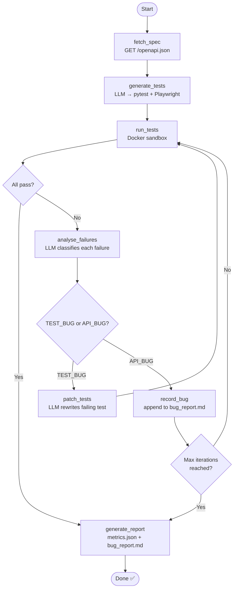

# 🤖 Autonomous API Testing & Code Generation Agent

An AI-powered agent that **autonomously discovers, tests, and diagnoses bugs** in a target REST API — with zero manual test writing. It reads the OpenAPI spec, generates pytest + Playwright tests via a local LLM (Ollama), runs them inside Docker, and iterates in a self-healing loop until it has fully characterised every failure as either a **TEST_BUG** (bad test) or **API_BUG** (real defect).

> **Black-Box Rule:** The agent never reads the API source code. It operates solely through the OpenAPI schema and HTTP responses — exactly as an external QA engineer would.

---

## 🏗️ Architecture



**LangGraph nodes:**

| Node | Responsibility |
|------|---------------|
| `fetch_spec` | Fetches `/openapi.json` from the target API |
| `generate_tests` | Calls Ollama LLM to synthesise pytest unit + Playwright E2E test files |
| `run_tests` | Spins up Docker Compose, runs pytest inside the sandbox container, captures JSON report |
| `analyse_failures` | Sends failing test name + traceback + OpenAPI context to LLM for TEST_BUG vs API_BUG classification |
| `patch_tests` | Asks LLM to rewrite only the failing test function; writes patched file back |
| `record_bug` | Appends a structured bug entry (ID, endpoint, expected, actual, evidence) to `reports/bug_report.md` |
| `generate_report` | Aggregates all metrics into `reports/metrics.json` and finalises the bug report |

---

## 🛠️ Tech Stack

| Layer | Technology |
|-------|-----------|
| Agent orchestration | [LangGraph](https://github.com/langchain-ai/langgraph) (cyclic state machine) |
| LLM inference | [Ollama](https://ollama.ai) — local, GPU-accelerated (default: `codellama:7b`) |
| Test framework | [pytest](https://pytest.org) + [pytest-json-report](https://github.com/numirias/pytest-json-report) |
| HTTP client (tests) | [httpx](https://www.python-httpx.org/) |
| Browser E2E | [Playwright](https://playwright.dev/python/) (Chromium, headless) |
| Target API | [FastAPI](https://fastapi.tiangolo.com/) (benchmark app with deliberate bugs) |
| Containerisation | Docker + Docker Compose |
| Python version | 3.11+ |

---

## 📋 Prerequisites

| Requirement | Version | Notes |
|-------------|---------|-------|
| **Docker Desktop** | 24.x+ | With Compose v2 (`docker compose` not `docker-compose`) |
| **Ollama** | 0.3.x+ | Running locally on port 11434 |
| **Python** | 3.11+ | For the agent process only; tests run inside Docker |
| **NVIDIA GPU** | RTX 3060+ (8 GB VRAM) | Strongly recommended for the 7B model; CPU-only is 10–20× slower |
| **CUDA / ROCm** | CUDA 12.x | Required for GPU acceleration with Ollama |
| **Git** | any | To clone the repo |

> [!TIP]
> On CPU-only machines, switch to a smaller model: `--model tinyllama:1b`. Quality degrades but it still works for simple APIs.

---

## 🚀 Quick Start

### 1. Clone the repository

```bash
git clone https://github.com/your-org/autonomous-api-testing-agent.git
cd autonomous-api-testing-agent
```

### 2. Install Python dependencies

```bash
pip install -r requirements.txt
```

### 3. Start Ollama and pull the model

```bash
# Start Ollama (if not already running as a service)
ollama serve &

# Pull the default code model
ollama pull codellama:7b
```

### 4. Start the benchmark target API

```bash
docker compose -f docker/docker-compose.yml up target_api -d
# Verify it's healthy:
curl http://localhost:8000/openapi.json | python -m json.tool | head -20
```

### 5. Run the agent

```bash
python -m agent.main \
  --target-url http://localhost:8000 \
  --model codellama:7b \
  --max-iterations 5 \
  --output-dir reports/
```

The agent will print live progress. When it finishes, open [`reports/bug_report.md`](reports/bug_report.md) to see the findings.

---

## ⚙️ How It Works

### Node-by-Node Walkthrough

#### 1. `fetch_spec`
Performs `GET {target_url}/openapi.json`. Parses the JSON into a structured spec object. Extracts every path, method, request schema, and response schema. This is the **only** source of truth the agent uses — no source code is ever read.

#### 2. `generate_tests`
Constructs a detailed prompt containing the full OpenAPI spec and instructs the LLM to produce:
- **`generated_tests/test_unit_endpoints.py`** — one pytest function per endpoint per scenario (happy path, auth missing, validation errors, edge cases).
- **`generated_tests/test_e2e_playwright.py`** — a stateful `TestFullUserJourney` class that walks through Register → Login → Create → Read → Update → Delete in order, sharing state via a `journey_state` fixture.

The LLM output is extracted, syntax-checked (`ast.parse`), and written to disk.

#### 3. `run_tests`
Runs `docker compose up --abort-on-container-exit sandbox` which:
1. Mounts `generated_tests/` and `reports/` into the sandbox container.
2. Executes `pytest --json-report --json-report-file=/reports/report.json`.
3. Collects the JSON report and parses pass/fail/error per test.

#### 4. `analyse_failures`
For each **failed** test, sends to the LLM:
- The test function source
- The full traceback
- The relevant OpenAPI path/method spec

The LLM returns a structured JSON verdict:

```json
{
  "test_id": "test_get_item_not_found",
  "classification": "API_BUG",
  "bug_id": "BUG-2",
  "explanation": "Endpoint raises unhandled KeyError → 500, spec requires 404",
  "expected_status": 404,
  "actual_status": 500
}
```

#### 5. `patch_tests` (TEST_BUG path)
When the LLM classifies a failure as `TEST_BUG` (e.g., wrong expected status code, incorrect request format), it rewrites **only** the failing function and injects it back into the test file. The agent then re-runs pytest. This prevents false positives from polluting the bug report.

#### 6. `record_bug` (API_BUG path)
Appends a Markdown section to `reports/bug_report.md`:
```markdown
## BUG-2 · GET /items/{item_id} — Missing 404 handler
- **Severity:** HIGH
- **Expected:** 404 Not Found
- **Actual:** 500 Internal Server Error
- **Evidence:** `test_get_item_not_found` traceback
- **Detected at:** 2026-11-12T11:30:00Z (iteration 2)
```

#### 7. `generate_report`
Writes `reports/metrics.json`:
```json
{
  "total_tests": 20,
  "passed": 17,
  "failed": 3,
  "api_bugs_found": 3,
  "test_bugs_fixed": 1,
  "iterations": 3,
  "duration_seconds": 142.7
}
```

### TEST_BUG vs API_BUG

| Classification | Meaning | Agent Action |
|----------------|---------|-------------|
| **TEST_BUG** | The test itself is wrong (bad assertion, wrong endpoint path, etc.) | Rewrite the test and re-run |
| **API_BUG** | The API deviates from its own OpenAPI spec | Record in bug report, continue |

The LLM is prompted with the OpenAPI spec as the **authoritative source** — if the spec says 204 and the API returns 200, that is an API_BUG regardless of whether 200 "makes sense" to a human.

---

## 🐛 Deliberate Bugs in `benchmark_app`

The benchmark FastAPI app ships with **3 intentional bugs** to validate the agent's detection capability:

| ID | Endpoint | Bug Description | Expected (spec) | Actual (buggy) | Severity |
|----|----------|----------------|-----------------|----------------|---------|
| **BUG-1** | `DELETE /items/{item_id}` | Returns `200 {"deleted": true}` instead of an empty 204 | `204 No Content` | `200 OK` | MEDIUM |
| **BUG-2** | `GET /items/{item_id}` | Unhandled `KeyError` when item not found — no 404 handler | `404 Not Found` | `500 Internal Server Error` | HIGH |
| **BUG-3** | `POST /items/` | `price` field silently stored as `0.0` regardless of input | `price` echoed from request | `price: 0.0` always | HIGH |

> [!CAUTION]
> These bugs are **intentional** and exist only in `benchmark_app/`. Do not use `benchmark_app` as a template for production APIs.

---

## 🔧 Configuration

### CLI Flags

```
usage: python -m agent.main [OPTIONS]

Options:
  --target-url URL       Base URL of the target API  [default: http://localhost:8000]
  --model MODEL          Ollama model name            [default: codellama:7b]
  --max-iterations N     Max self-healing iterations  [default: 5]
  --output-dir DIR       Directory for reports        [default: reports/]
  --ollama-url URL       Ollama server URL            [default: http://localhost:11434]
  --no-docker            Run pytest locally (no Docker sandbox)
  --keep-containers      Do not `docker compose down` after tests
  --log-level LEVEL      Logging verbosity            [default: INFO]
  --help                 Show this message and exit
```

### Environment Variables

| Variable | Default | Description |
|----------|---------|-------------|
| `TARGET_API_URL` | `http://localhost:8000` | Base URL passed into Docker sandbox |
| `OLLAMA_BASE_URL` | `http://localhost:11434` | Ollama API endpoint |
| `OLLAMA_MODEL` | `codellama:7b` | Model to use for generation and analysis |
| `MAX_ITERATIONS` | `5` | Maximum self-healing loop iterations |
| `AGENT_LOG_LEVEL` | `INFO` | Python logging level |
| `DOCKER_COMPOSE_FILE` | `docker/docker-compose.yml` | Path to Compose file |

> [!NOTE]
> CLI flags take precedence over environment variables.

---

## 📂 Output Files

### `reports/metrics.json`

```json
{
  "run_id": "20261112-113045",
  "target_url": "http://localhost:8000",
  "model": "codellama:7b",
  "total_tests": 20,
  "passed": 17,
  "failed": 3,
  "skipped": 0,
  "api_bugs_found": 3,
  "test_bugs_patched": 1,
  "iterations": 3,
  "duration_seconds": 142.7,
  "bugs": ["BUG-1", "BUG-2", "BUG-3"]
}
```

### `reports/bug_report.md`

A human-readable Markdown report with one section per confirmed API bug:

```markdown
# API Bug Report — 2026-11-12T11:30:45Z

## Summary
3 API bugs detected across 3 iterations (20 tests, 17 passed).

## BUG-1 · DELETE /items/{item_id} — Wrong status code
...

## BUG-2 · GET /items/{item_id} — Missing 404 handler
...

## BUG-3 · POST /items/ — price silently zeroed
...
```

### `reports/report.json`

Raw pytest JSON report from the final test run (produced by `pytest-json-report`). Contains per-test `outcome`, `duration`, `call.longrepr` (traceback), and metadata.

---

## 🔌 Extending — Plug In a Different Target API

To test **your own** API instead of the benchmark app:

### Step 1: Point the agent at your API

```bash
python -m agent.main \
  --target-url https://your-api.example.com \
  --max-iterations 10
```

The agent will fetch `/openapi.json` automatically. Your API must expose an OpenAPI 3.x schema at that path (FastAPI, Django REST Framework with drf-spectacular, etc.).

### Step 2: Customise fixtures (optional)

If your API has a non-standard auth flow, edit `generated_tests/conftest.py` **before** running the agent (the agent regenerates these files, so keep a backup or fork the generation prompt). You can inject your fixture overrides by passing a `--conftest-patch` file:

```bash
python -m agent.main \
  --target-url https://your-api.example.com \
  --conftest-patch my_auth_fixtures.py
```

### Step 3: Adjust the generation prompt (advanced)

The LLM prompt template lives in `agent/prompts/generate_tests.jinja2`. Edit it to:
- Change expected response codes for your domain
- Add domain-specific edge cases
- Exclude certain endpoints from testing

### Step 4: Run with more iterations for complex APIs

```bash
python -m agent.main \
  --target-url https://your-api.example.com \
  --max-iterations 15 \
  --model codellama:13b   # larger model for better accuracy
```

---

## 📁 Project Structure

```
autonomous-api-testing-agent/
├── agent/                     # Agent source code (LangGraph nodes)
│   ├── main.py                # Entry point & graph definition
│   ├── nodes/                 # One module per LangGraph node
│   │   ├── fetch_spec.py
│   │   ├── generate_tests.py
│   │   ├── run_tests.py
│   │   ├── analyse_failures.py
│   │   ├── patch_tests.py
│   │   ├── record_bug.py
│   │   └── generate_report.py
│   ├── prompts/               # Jinja2 LLM prompt templates
│   │   ├── generate_tests.jinja2
│   │   └── analyse_failure.jinja2
│   └── state.py               # LangGraph AgentState TypedDict
├── benchmark_app/             # Target FastAPI app (with deliberate bugs)
│   ├── main.py
│   ├── models.py
│   └── Dockerfile.target
├── docker/
│   ├── Dockerfile.sandbox     # pytest + Playwright runner container
│   └── docker-compose.yml     # Wires target_api + sandbox together
├── generated_tests/           # LLM-generated tests (overwritten each run)
│   ├── conftest.py            # Shared fixtures (seed template)
│   ├── test_unit_endpoints.py
│   └── test_e2e_playwright.py
├── reports/                   # Agent output (gitignored except .gitkeep)
│   ├── .gitkeep
│   ├── metrics.json           # (generated)
│   ├── bug_report.md          # (generated)
│   └── report.json            # (generated — raw pytest JSON)
├── requirements.txt           # Python deps for the agent
└── README.md
```

---

## 🤝 Contributing

1. Fork the repo and create a feature branch.
2. Run the agent against the benchmark app to verify your changes don't break detection.
3. Add a test in `tests/` (unit tests for the agent itself, not the generated tests).
4. Open a PR — CI will run the agent in Docker against the benchmark app.

---

## 📄 License

MIT — see [LICENSE](LICENSE).
